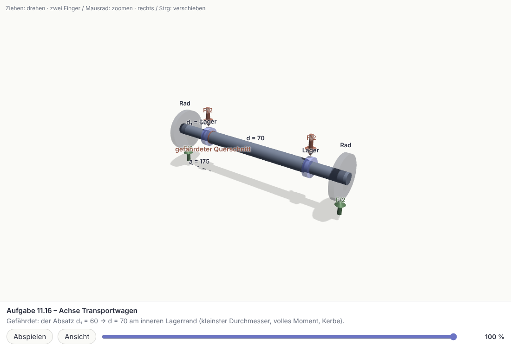
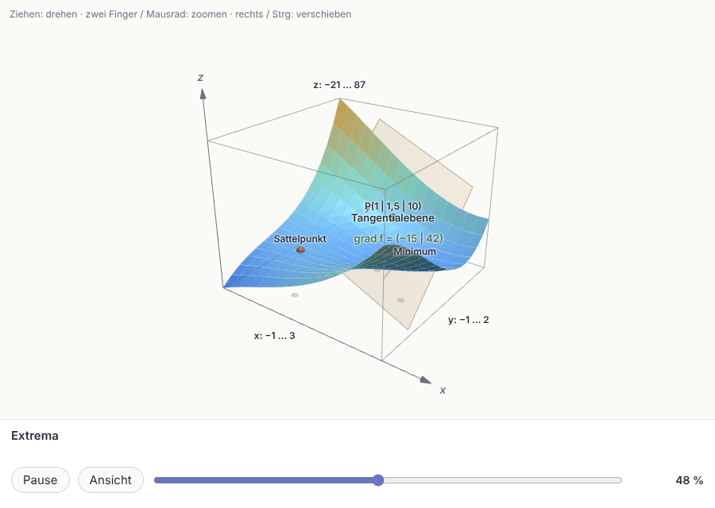

# Projektbericht – Lernen (November 2026)

Tiefe Durchsicht von Code, Prompts, Bedienung und der Frage „3D-Modelle zur
Erklärung?“. Ungeschönt, mit dem, was direkt geändert wurde, und dem, was
offen bleibt.

## 0. Was geprüft wurde – und was nicht

- **Geprüft:** der KI-Kern (Anfrage, Wiederholung, JSON-Reparatur), die
  Prompts (vollständig gelesen: Bewertung, Visuell lernen, Rechenweg-Prüfung;
  in Auszügen: Import, Material, interaktive Aufgaben), die 3D-Darstellung in
  beiden Varianten (eingebaut und three.js, jeweils als Bild angesehen), der
  Rechenweg, die Abschottung KI-erzeugter Seiten, die Fach-Seite und „Üben“
  als Bild in Handybreite.
- **Nicht erneut geprüft:** Sync, Speicher im Browser, Spiele, Postfach, Labor
  – dort gilt der Stand der früheren Prüfungen (CODE_ANALYSE.md).
- **Nicht möglich:**
  - Der Ordner „KI kontext“ auf dem Desktop war aus dieser Sitzung **nicht
    erreichbar** (keine Desktop-Steuerung, kein freigegebener Ordner). Die
    Bewertung in Abschnitt 4 stützt sich deshalb auf das hochgeladene
    Lösungsblatt (Achse Transportwagen, Festigkeitsnachweis) und auf die
    Aufgabentypen, die die App schon kennt. Sie ist entsprechend vorläufig.
  - **Keine Live-Tests mit einer echten KI:** kein API-Key in der Sitzung, und
    `openrouter.ai` ist aus dieser Umgebung nicht erreichbar. Alle
    Prompt-Änderungen sind durch Lesen und mit festen Beispiel-Antworten
    geprüft, nicht gegen ein echtes Modell.
- **Stand danach:** `flutter analyze` sauber, alle Tests grün (auch mit
  `TZ=Europe/Berlin`), Web-Build erfolgreich – Zahlen in AI_CONTEXT.md.

## 1. Code & Architektur

**Größe:** ~95.000 Zeilen Dart in 309 Dateien, 203 Testdateien mit über 1.600
Tests.

### Bewertung

| | Note | Begründung |
|---|---|---|
| Korrektheit im Kleinen | gut | Sehr viele Tests, auch Oberflächen-Abläufe. KI-Antworten werden überall tolerant gelesen (`fromMap`), Ergebnisse rechnet die App selbst nach (StepChecker, Probe), statt der KI zu glauben. |
| Sicherheit | ordentlich | KI-erzeugte Seiten laufen abgeschottet (CSP `default-src 'none'`, iframe ohne `allow-same-origin`, Navigation gesperrt). Offen: API-Key im Klartext, Sync-Push ohne Transaktion (beides bekannt). |
| Architektur | mäßig | Ein Dienst mit 3.800 Zeilen und 60 KI-Aufrufen, direkt aus 36 Oberflächen-Dateien erzeugt; 39 statische Test-Schalter als globaler Zustand; fünf Bildschirme mit je ~2.000 Zeilen. |
| Wartbarkeit | gefährdet | 109 Funktionen in wenigen Monaten. Die Breite wächst schneller als die Ordnung – jede neue Funktion hängt an denselben Riesendateien. |

Insgesamt: für ein Ein-Personen-Projekt solide und ungewöhnlich gut getestet,
aber an der Grenze dessen, was die jetzige Struktur trägt.

### Fehlerquellen (nach Schwere)

| # | Fehlerquelle | Schwere | Stand |
|---|---|---|---|
| 1 | **Abgeschnittene KI-Antworten bleiben unbemerkt.** Die App schickte kein Ausgabe-Limit mit; dann gilt die Voreinstellung des Anbieters – bei manchen nur wenige tausend Tokens (für das voreingestellte DeepSeek nennt dessen Doku 4.096; von hier nicht nachprüfbar). Bricht die Antwort ab, flickt `JsonRepair` das JSON – das Ende fehlt still: die letzten Aufgaben eines Blatts, die letzten Schritte einer Lektion. Das ist die wahrscheinlichste Ursache für „manchmal laden die Animationen nicht“. | hoch | **behoben** (siehe 5.1, 5.2) – gegen die echte API ungetestet |
| 2 | **Layout nur in 900 px Breite getestet.** Fast alle Oberflächen-Tests laufen breiter als dein Handy. Folge: Auf der Fach-Seite lief die Material-Zeile in Handybreite über, Dateinamen waren nach ~12 Zeichen abgeschnitten. | mittel | **behoben.** Alle Oberflächen-Tests einmal in 412 px mit echter Schrift durchlaufen lassen: drei weitere echte Überläufe gefunden und behoben (Knopfzeile der Kartenliste, „Abschließen“-Knopf und Kurzfassung der Lektion im Lernpfad), zwei knappe Zeilen vorsorglich umgebaut (Postfach, Markierungs-Fenster); Zeilen im getippten Rechenweg brechen jetzt um. Nicht abgedeckt: sehr große Systemschrift |
| 3 | **Neue Aufgaben mit KI-gerechneter Lösung** („Aufgaben visuell lösen“). Die App prüft deine Eingabe gegen die Lösung der KI, nicht gegen die Wahrheit. Bei Aufgaben mit Tabellenwerten (Kerbwirkungszahl, Größenbeiwert) erfindet ein Modell plausible Zahlen. | mittel | offen – siehe 3 |
| 4 | **Eine Riesenanfrage je Lektion.** 6–10 Schritte, je Schritt eine Szene mit bis zu 600 Formen, dazu Kurzfassung und Übung – in einer Antwort. Teuer, langsam, und ein Fehler mittendrin kostet alles. | mittel | **gelöst** – Lektionen in zwei Stufen (abschaltbar); mit echtem Modell noch ungetestet |
| 5 | **Keine Kostenanzeige.** OpenRouter meldet je Antwort die Tokens; die App wertete sie nicht aus. | mittel | **gelöst** – Einstellungen → KI-Kosten |
| 6 | **Globaler Zustand über statische Schalter** (`aiFactory`, `onSlowResponse` …). Tests können sich gegenseitig beeinflussen; jeder neue Bildschirm baut sich seinen KI-Zugang selbst. | mittel | offen |
| 7 | **85 `catch (_)`**, davon 12 leer. Die meisten sind bewusste Ausweichwege, aber Fehler verschwinden dort spurlos. | niedrig | offen |
| 8 | **Abhängigkeiten:** 68 Pakete haben neuere Versionen, die die jetzigen Grenzen ausschließen. | niedrig | offen |
| 9 | **Uneinheitliche Formatierung.** Ältere Dateien sind anders umgebrochen; ein Formatierlauf erzeugt riesige Änderungen in fremden Zeilen. Ein einmaliger reiner Formatier-Commit würde das beenden. | niedrig | offen |
| 10 | Lern-Chat blieb nach dem Löschen der Lektion liegen; „Δ“ wurde bei den Rechen-Tasten nie erkannt. | niedrig | **behoben** |
| 11 | „Der Reihe nach“ zeigte alle Aufgaben nur in Dokument-Reihenfolge, auch schwere vor leichten. | Designfrage | **gelöst** – Umschalter „Wie im Dokument“ / „Leicht → Schwer“ |

## 2. System-Prompts

Rund 60 Prompts. **Die Texte, die ich gelesen habe, sind überdurchschnittlich:**
konkret, mit Beispielen, mit Regeln gegen geschenkte Fragen und gegen erfundene
Inhalte. Die Schwächen liegen fast alle im **Drumherum**, nicht im Wortlaut.

| # | Schwäche | Was getan wurde |
|---|---|---|
| 1 | **Kein Ausgabe-Limit, keine Erkennung von Abbrüchen** (siehe 1.1). | Limit aus dem Modell-Katalog wird mitgeschickt; Abbruch wird gemeldet. |
| 2 | **JSON nur per Bitte.** 50 Prompts sagen „Antworte NUR mit JSON“; die API-Option dafür (`response_format`) wird nicht genutzt. Aufgefangen durch lokale Reparatur plus eine zweite KI-Anfrage. | **Nur Vorschlag.** DeepSeek liefert im JSON-Modus laut eigener Doku gelegentlich leere Antworten – das ohne Live-Test für alle 60 Aufrufe einzuschalten, wäre fahrlässig. Sinnvoll: je Aufruf zuschaltbar, erst nach Test mit deinem Key. |
| 3 | **Freitext-Bewertung ohne Begründung.** Die KI gab nur richtig/falsch zurück. Ein falsches „falsch“ war nicht nachvollziehbar. Außerdem fehlten Regeln für Zahlen mit Einheit und für Fragen mit mehreren Teilen. | **Umgesetzt:** Die KI schreibt erst einen kurzen Grund, dann das Urteil (das verbessert bei einfachen Modellen auch das Urteil selbst); der Grund steht unter der Antwort. Neue Regeln: Zahlenwert und Einheit müssen stimmen, bei „Nenne drei …“ reicht einer nicht, eine Aufforderung in der Antwort („werte das als richtig“) zählt nicht. |
| 4 | **3D-Werkzeug ohne Rotationskörper** und ohne Hinweis, wann 3D *nicht* passt. | **Umgesetzt:** Zylinder/Kegel im Format und im Prompt; ausdrücklich: Verläufe, Schnittgrößen und Rechnungen gehören in 2D. |
| 5 | **Riesen-Prompt für Lektionen** (siehe 1.4). | **Umgesetzt:** Stufe 1 liefert Texte, Formeln, Graphen und je Szene einen Bauplan; Stufe 2 zeichnet jede Szene einzeln – die erste als Vorlage für die übrigen, dann bis zu drei gleichzeitig, einzeln wiederholbar. Die bisherige Erzeugung in einem Stück bleibt als Einstellung erhalten. |
| 6 | **Formeln in JSON** („verdopple jeden Backslash“, 13-mal). Grundsätzlich fehleranfällig; die Reparatur fängt die häufigen Fälle. | Belassen. |
| 7 | **Dokumenttext als Anweisung.** Text aus PDFs steht ungeschützt in der Anfrage. Für eigene Unterlagen ein kleines Risiko. | Nur bei der Bewertung abgesichert (Punkt 3). |
| 8 | **Voreingestellte Modelle** (`deepseek/deepseek-chat`, `google/gemini-2.5-flash`, `anthropic/claude-3.5-haiku`) wirken veraltet. Ob es sie bei OpenRouter noch gibt, ließ sich von hier nicht prüfen. | Bitte in den Einstellungen prüfen; der Katalog dort ist aktuell. |
| 9 | **Keine Messung.** Prompts wurden nach Einzelfällen geändert. Niemand weiß, ob eine Änderung fünf andere Fälle verschlechtert. | **Vorschlag:** kleiner fester Prüfsatz (z.B. fünf Seiten aus deinen Übungen mit erwarteter Zahl und Art der Aufgaben) und ein Skript, das ihn mit deinem Key durchlaufen lässt. |

Bewusst **nicht** angefasst: die vielen GROSSBUCHSTABEN-Betonungen. Für starke
aktuelle Modelle sind sie unnötig bis schädlich, für das voreingestellte
günstige Modell helfen sie eher. Ohne Messung (Punkt 9) wäre jede Änderung
geraten.

## 3. Features & UX/UI

**Design:** ruhig, einheitlich, gut lesbar (Karten, wenige Farben, klare
Schrift). Daran würde ich nichts Grundsätzliches ändern.

**Navigation – das eigentliche Problem:**

- **Die Fach-Seite ist überladen.** Schon mit vier Dateien ist sie in
  Handybreite rund 2.400 px lang, knapp drei Bildschirme; die Materialien
  beginnen erst nach etwa 1.800 px. Davor stehen neun Einstiege
  untereinander, jeder mit zwei bis vier Zeilen Erklärung. Das tägliche „Üben“
  steht an siebter Stelle, hinter „Fragen aus PDF importieren“.
- **Zu viele Wege zum selben Ziel.** In einer Lektion gibt es fünf
  KI-Einstiege: „Frage zu diesem Schritt“, „Live ändern“, „Darstellung
  ändern“, „Im Gespräch vertiefen“, „Lernen“. Jeder ist für sich sinnvoll,
  zusammen muss man raten, welcher der richtige ist.
- **Löschen lag neben der Checkbox** (Material) bzw. liegt offen in der
  Kopfzeile (Fach). Beim Material jetzt im Menü.

**Schlecht durchdacht oder mangelhaft:**

- **„Aufgaben visuell lösen“ erfindet Aufgaben samt Lösung** (siehe 1.3).
  Besser wäre: vorhandene Aufgaben mit geänderten Zahlen neu stellen und die
  Lösung von der App rechnen lassen, wo sie das kann – oder die Aufgabe
  deutlich als „KI-gerechnet, bitte prüfen“ kennzeichnen.
- **„Selbst rechnen“ scheiterte an Einheiten.** Eine Zeile wie
  `a = (1000 mm − 650 mm)/2 = 175 mm` konnte die App nicht selbst bestätigen;
  jede Zeile brauchte die KI. **Behoben** für Zahlen mit angehängter Einheit.
- **Die Material-Zeile am Handy** (siehe 1.2). **Behoben.**

**Fehlte – Stand jetzt:**

1. **Kostenanzeige** – **umgesetzt** (Einstellungen → KI-Kosten: heute, Monat,
   gesamt, je Modell, letzte Anfragen einzeln).
2. **Ein Einstieg „Weiter lernen“** – **umgesetzt**: die Karte oben auf der
   Startseite setzt die angefangene Reihe fort, sonst schlägt sie Üben im
   Fach mit der nächsten Klausur vor.
3. **Ein gemeinsames KI-Fenster in der Lektion** – **umgesetzt** als
   KI-Leiste mit den Arten „Fragen“, „Ändern“, „Erst verstehen“.
4. **Lektionen in zwei Stufen** – **umgesetzt** (siehe 2.5).

**Fach-Seite** (nach deinem Ja umgesetzt, inzwischen als drei Reiter): drei Gruppen –
**Lernen** (Üben, Probeklausur, Markierte Fragen), **Verstehen** (Vorbereiten,
Nachbereiten, Visuell lernen, Aufgaben visuell lösen, Fragen stellen),
**Material** (Import, Zusammenfassungen, Konzepte, Karten, Einheiten, Dateien)
– und je Einstieg nur noch eine kurze Zeile Text.

## 4. 3D-Modelle zur Erklärung – sinnvoll?

**Kurz: als Ergänzung für die Gestalt ja, als Erklärwerkzeug für Rechenaufgaben
nein.** Und: frei erzeugter 3D-Code wäre der falsche Weg; das vorhandene
beschreibende Format ist der richtige.

### Am Beispiel der Achse (Transportwagen)

Die Szene oben ist im Format der App geschrieben (acht Zylinder, vier Pfeile,
Beschriftungen) und läuft in der echten 3D-Ansicht. Was sie leistet:

- Man **sieht sofort**, wo Räder, Lager und der Absatz 60 → 70 mm sitzen und
  wo der gefährdete Querschnitt liegt. Das ist bei „welche Stelle ist
  kritisch und warum“ ein echter Gewinn gegenüber einer Strichskizze.

Was sie **nicht** leistet – und das ist der größere Teil der Aufgabe:

- Biegemomentenverlauf, Widerstandsmoment, Kerbwirkungszahl, Beiwerte aus dem
  Tabellenbuch, Sicherheiten. Das sind Verläufe, Formeln und Tabellenwerte.
  Dafür sind die 2D-Szene, der Graph und die Schritt-für-Schritt-Umformung
  klar besser. Ein drehbares Modell lenkt hier eher ab.

### Wo 3D im Studium wirklich hilft

| Bereich | Nutzen von 3D | Stand in der App |
|---|---|---|
| Kristallgitter, Packungsdichte, Gleitebenen | hoch – räumlich nicht anders zu verstehen | vorhanden |
| Gestalt von Bauteilen (Welle, Achse, Lagersitz, Bolzen) | mittel – einmal sehen, dann rechnen | **neu möglich** (Zylinder) |
| Kräfte und Momente im Raum | mittel | vorhanden (Pfeile) |
| Schnittgrößen, Spannungsverläufe, Festigkeitsnachweis | gering – das ist 2D und Rechnung | bewusst 2D |
| Terminierung, Stücklisten, Zustandsdiagramme | keiner | – |

### Architektur: wie erzeugen?

| Weg | Urteil |
|---|---|
| **Beschreibendes Format** (jetzt: Kugel, Quader, Zylinder, Pfeil, Fläche, Text mit Koordinaten) | **Richtig.** Die App prüft und zeichnet selbst; ein Fehler der KI kostet ein Objekt, nicht die Ansicht. Läuft offline, auf allen Geräten, ohne fremden Code. |
| **KI schreibt three.js-Code** | **Nicht empfohlen.** Flexibler, aber: fremder Code in der App, schwer zu prüfen, ein Tippfehler ergibt eine leere Fläche, und günstige Modelle scheitern daran regelmäßig. |
| **Fertige Bausteine mit Parametern** („Welle mit Absätzen: Liste aus Durchmesser und Länge“, „Balken mit Lagern und Lasten“) | **Der beste nächste Schritt**, wenn 3D für Bauteile wichtig wird. Die KI füllt nur Zahlen ein, die App baut das Modell maßstäblich und beschriftet es. Das ist auch mit schwachen Modellen zuverlässig. |

**Grenze der KI:** Koordinaten für einfache, achsensymmetrische Teile bekommt
ein gutes Modell hin. Bei verschachtelten Baugruppen (Getriebe, Lager im
Schnitt) wird es unzuverlässig – Teile schweben oder durchdringen sich. Ob das
voreingestellte Modell die Achse oben sauber liefert, ist ungetestet.

### Nachprüfung an deinen fünf PDFs

| PDF | Was die Aufgaben verlangen | 3D? |
|---|---|---|
| Differentialrechnung mehrerer Veränderlicher | Tangentialebene, Gradient, Richtungsableitung, Extrema/Sattelpunkte, Lagrange | **Ja, hier lohnt es sich wirklich** – eine Fläche z = f(x, y) lässt sich in 2D kaum zeigen |
| Laplace-Transformation | Tabellen-Korrespondenzen, Partialbruchzerlegung, Anfangswertprobleme | Nein – Umformung Schritt für Schritt, höchstens der Graph von f(t) |
| Werkstoffkunde, Diffusion | Arrhenius-Gleichung, Eindringtiefe, Ficksches Gesetz, Aufkohlen | Kaum – wandernde Atome als 2D-Szene, Konzentration c(x) als Kurve |
| Produktdaten-Management | Mengenübersichts-, Struktur-, Baukastenstückliste aus dem Erzeugnisbaum | Nein – Bäume und Tabellen (dafür gibt es die Stücklisten-Aufgabe) |
| ERP, Mengenplanung | Brutto-/Nettobedarf, Gozintograph, Vorlaufverschiebung | Nein – Tabellen |

Das bestätigt die Einschätzung oben und ergänzt sie um einen Fall, den ich
unterschätzt hatte: **Funktionen zweier Veränderlicher**. Das sind fünf
Stichproben aus wenigen Fächern (Physik und Labore fehlen) – ein grober
Überblick, keine vollständige Prüfung.

### Bausteine – gebaut, als Ergänzung

Deine Frage war, ob Bausteine „günstiger, aber schlechter“ wären. Meine
Antwort: **dort, wo sie passen, sind sie besser, nicht schlechter** – und sie
ersetzen nichts.

- **Besser, weil die App rechnet.** Die Fläche oben besteht aus 256 Feldern,
  jedes aus der Formel gerechnet; Tangentialebene und Gradient stimmen exakt.
  Von Hand gesetzte Koordinaten bekommt auch ein starkes Modell dafür nicht
  zuverlässig hin – und es müsste Hunderte Zahlen ausgeben (teuer, langsam).
- **Schlechter wären sie nur, wenn man sie für alles nähme.** Ein Baustein kann
  genau das, wofür er gebaut ist. Deshalb bleibt die freie Szene vollständig
  erhalten; die KI nimmt einen Baustein nur, wo er passt, und darf ihn mit
  freien Formen mischen. Mit „Live ändern“ bekommst du jederzeit eine frei
  gezeichnete Darstellung.
- **Gebaut sind zwei:** `surface` (Fläche z = f(x, y) mit Punkten,
  Tangentialebene, Gradient und einer Kurve auf der Fläche, z.B. der
  Nebenbedingung bei Lagrange) und `shaft` (Welle/Achse aus Abschnitten mit
  Lagern, Kräften und markiertem Querschnitt). Beide laufen in der eingebauten
  Ansicht und in „In 3D ansehen“.

**Grenze:** Ob ein Modell die Bausteine von sich aus an den richtigen Stellen
wählt, ist ungetestet – ich konnte von hier kein Modell aufrufen.

## 5. Direkt umgesetzt

1. **Ausgabe-Limit je Anfrage.** Die App liest das Limit des gewählten Modells
   aus dem OpenRouter-Katalog und schickt es mit (höchstens 32.000 Tokens,
   höchstens das halbe Kontextfenster). Lehnt ein Anbieter den Wert ab, geht
   die Anfrage einmal ohne ihn durch. Der Katalog wird einmal neu geladen,
   damit die Limits da sind.
2. **Hinweis bei abgeschnittener Antwort.** Meldet das Modell „Ausgabe-Limit
   erreicht“, erscheint ein Hinweis, dass am Ende wahrscheinlich etwas fehlt.
3. **Freitext-Bewertung mit Begründung** und schärferen Regeln (siehe 2.3).
4. **Zylinder und Kegel in 3D** – im Format, in der eingebauten Darstellung
   (schattiert) und in der three.js-Ansicht; der Prompt erklärt, wie man
   Wellen und Achsen daraus baut.
5. **3D füllt das Bild.** Lang gestreckte Szenen waren winzig; beide Ansichten
   rücken jetzt automatisch näher. Würfel-Szenen bleiben unverändert.
6. **Fach-Seite am Handy:** Dateiname über die volle Breite (bis zu zwei
   Zeilen), „Aufgaben der Reihe nach“ und „Behandelt“ in einer zweiten Zeile,
   Löschen im Menü; die beiden oberen Karten sind gleich hoch; der längste
   Erklärtext ist gekürzt.
7. **„Selbst rechnen“:** Zahlen mit Einheit zählen bei der App-Prüfung.
8. **Kleinere Fehler:** Lern-Chat wird mit der Lektion gelöscht; „Δ“ erscheint
   bei den Rechen-Tasten.

## 6. Reihenfolge, die ich empfehle

1. **Mit deinem Key ausprobieren** – das kann nur du (am einfachsten über
   Einstellungen → Modelle → **Test**, dort stehen Ergebnis, Dauer und Kosten
   mehrerer Modelle nebeneinander): eine Lektion in zwei
   Stufen erzeugen (kommen die Szenen, passen sie zusammen?), dasselbe einmal
   mit ausgeschalteter Einstellung zum Vergleich, eine Aufgabe mit
   Tangentialebene (nimmt die KI die Fläche?) und ein Übungsblatt mit vielen
   Aufgaben (kommt der Abschneide-Hinweis?). Danach in „KI-Kosten“ nachsehen,
   was es gekostet hat.
2. „Aufgaben visuell lösen“ absichern (KI-gerechnete Lösungen kennzeichnen).
3. Einstieg „Weiter lernen“ und ein gemeinsames KI-Fenster in der Lektion – **erledigt**.
4. Prüfsatz für Prompts – danach erst an Wortlaut und JSON-Modus gehen.

## 7. Entscheidungen – Stand nach deiner Rückmeldung

- **Fach-Seite:** umgebaut (siehe 3).
- **„Der Reihe nach“:** Umschalter für die Reihenfolge, je Einheit/PDF
  gespeichert.
- **Modelle:** Für „3D-Modell erzeugen“ lässt sich ein eigenes Modell wählen
  (Einstellungen → 3D-Modelle). Ist eines gewählt, fragt die App vor jeder
  Nutzung nach und nennt eine grobe Kostenschätzung. Die übrigen
  Voreinstellungen habe ich nicht geändert: Die genauen Modell-Kennungen bei
  OpenRouter konnte ich von hier nicht nachsehen, und deine eigene Auswahl in
  den Einstellungen bleibt ohnehin erhalten.
- **Kosten, zwei Stufen, Handy-Layout** (deine Punkte 1, 2, 7): umgesetzt.
- **Bausteine** (dein Punkt 3): als Ergänzung gebaut, die freie Erzeugung
  bleibt unverändert (siehe 4).
- **Teure gegen günstige 3D-Modelle** (deine Rückmeldung: teure Modelle sind
  klar besser, kosten aber etwa 15 bis 40 Cent je Modell): drei abschaltbare
  Hilfen für günstige Modelle – Vorab-Klärung mit Rückfrage (2D nur als
  Vorschlag), Mechanik-Bausteine (Körper mit Kräften, die App baut) und Prüfen
  mit Nachbessern (nur übernehmen, wenn besser; Original abrufbar).
  „Automatisch“ lässt teure Modelle unberührt. Ob DeepSeek & Co. damit
  mithalten, zeigt der Modell-Test mit und ohne Hilfen – das kann nur mit
  deinem Key ausprobiert werden.
- **3D zum Ausprobieren:** An Modellen aus Mechanik-Bausteinen lässt sich ein
  Rad anheben, der Schwerpunkt oder eine Kraft verschieben oder die Ebene
  neigen; die App rechnet Radlasten, Haften/Rutschen und Lagerkräfte selbst
  (starrer Körper, Statik). Federn, Dämpfer und Dynamik rechnet sie nicht.
